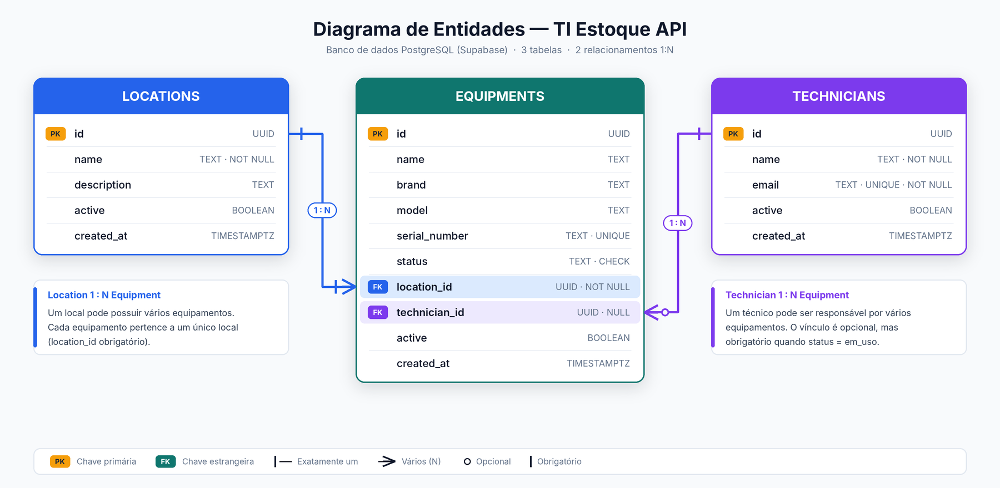

# TI Estoque API

## 4.1. Nome e descrição do projeto

**TI Estoque API** é uma API REST para gerenciamento do estoque de equipamentos do setor de Tecnologia da Informação.

O projeto busca resolver o problema do controle disperso de notebooks, monitores e periféricos, permitindo consultar onde cada equipamento está armazenado, qual técnico é responsável por ele e qual é seu status.

**Objetivo:** disponibilizar operações de cadastro, consulta, atualização e exclusão de locais, técnicos e equipamentos, mantendo os relacionamentos e as regras de negócio do domínio de gestão de ativos de TI.

## 4.2. Integrantes da equipe

- Bianca Mazepa Millek
- Gustavo Britto Triaquim

## 4.3. Tecnologias utilizadas

| Tecnologia/ferramenta | Utilização |
|---|---|
| Node.js | Ambiente de execução JavaScript |
| TypeScript | Tipagem e desenvolvimento da aplicação |
| Express | Criação das rotas e da API REST |
| Supabase | Serviço utilizado para acesso ao banco |
| PostgreSQL | Banco de dados relacional |
| Vitest | Execução dos testes automatizados |
| Supertest | Testes de integração dos endpoints |
| @vitest/coverage-v8 | Geração da cobertura de testes |
| Swagger/OpenAPI | Documentação interativa da API |
| Git | Versionamento do código |
| dotenv | Leitura das variáveis de ambiente |
| cors | Configuração de CORS |
| tsx | Execução do TypeScript durante o desenvolvimento |

## 4.4. Entidades e relacionamentos

A aplicação possui três entidades relacionadas:

### Location (locations)

Representa os locais onde os equipamentos ficam armazenados.

- `id`: identificador UUID (chave primária).
- `name`: nome do local.
- `description`: descrição do local.
- `active`: indica se o local está ativo.
- `created_at`: data de criação.

### Technician (technicians)

Representa os técnicos responsáveis pelos equipamentos.

- `id`: identificador UUID (chave primária).
- `name`: nome do técnico.
- `email`: e-mail único do técnico.
- `active`: indica se o técnico está ativo.
- `created_at`: data de criação.

### Equipment (equipments)

Representa os equipamentos cadastrados no estoque de TI.

- `id`: identificador UUID (chave primária).
- `name`: nome do equipamento.
- `brand`: marca.
- `model`: modelo.
- `serial_number`: número de série único.
- `status`: situação do equipamento.
- `location_id`: referência ao local (chave estrangeira obrigatória).
- `technician_id`: referência ao técnico (chave estrangeira opcional).
- `active`: indica se o registro está ativo.
- `created_at`: data de criação.

### Diagrama de relacionamento



**Relacionamentos:**

- **Location 1:N Equipment:** um local pode possuir vários equipamentos. Cada equipamento deve estar vinculado a um único local por meio de `location_id`.
- **Technician 1:N Equipment:** um técnico pode ser responsável por vários equipamentos. Um equipamento pode não ter técnico vinculado; quando seu status é `em_uso`, o técnico é obrigatório.
- As entidades utilizam UUID como identificador e os vínculos são implementados por chaves estrangeiras no PostgreSQL.

**Status permitidos para equipamentos:** `disponivel`, `em_uso`, `manutencao` e `baixado`.

## 4.5. Regras de negócio

As regras de negócio são implementadas principalmente na camada de Services.

### Equipamentos

- O número de série deve ser único. Tentativas de duplicidade retornam `409`.
- O local informado deve existir e estar ativo. Caso contrário, a operação retorna `422`.
- Quando informado, o técnico deve existir e estar ativo. Caso contrário, a operação retorna `422`.
- Um equipamento com status `em_uso` deve possuir um técnico responsável. Caso contrário, retorna `400`.
- Um equipamento com status `disponivel` não pode possuir técnico responsável. Caso contrário, retorna `422`.
- Um equipamento com status `baixado` não pode ter seu status alterado. A operação retorna `422`.
- Um equipamento com status `em_uso` não pode ser excluído. A operação retorna `409`.

### Técnicos

- O e-mail deve ser único e é normalizado para letras minúsculas.
- Um técnico responsável por equipamentos não pode ser desativado nem excluído. A operação retorna `409`.

### Locais

- Um local que possui equipamentos não baixados não pode ser desativado. A operação retorna `409`.
- Um local que possui equipamentos vinculados não pode ser excluído. A operação retorna `409`.

## 4.6. Estrutura do projeto

A aplicação está organizada em camadas, separando as responsabilidades:

```text
src/
├── config/          # Configuração e conexão com o Supabase
├── controllers/     # Recebem requisições e retornam respostas HTTP
├── docs/             # Documentação Swagger e regras de negócio
├── errors/           # Classe de erro da aplicação
├── middlewares/      # Tratamento de erros e rotas não encontradas
├── models/           # Interfaces, entidades e validações
├── repositories/     # Acesso e persistência dos dados
├── routes/           # Definição e organização das rotas
├── services/         # Regras de negócio e operações da aplicação
├── tests/
│   ├── integration/  # Testes de integração com Supertest
│   └── unit/         # Testes unitários
├── app.ts            # Configuração da aplicação Express
└── server.ts         # Inicialização do servidor

database/
└── schema.sql        # Estrutura do banco de dados

vitest.config.ts      # Configuração dos testes e da cobertura
```

**Fluxo das requisições:** `Route → Controller → Service → Repository → Supabase/PostgreSQL`.

Os Services recebem os Repositories por meio do construtor (injeção de dependência), permitindo substituir dependências por mocks nos testes unitários.

## 4.7. Configuração e execução

### Pré-requisitos

- Node.js e npm instalados.
- Conta e projeto no Supabase.
- Git instalado.

### 1. Clonar o repositório

```bash
git clone <url-do-repositorio>
cd ti-estoque-api
```

### 2. Instalar as dependências

```bash
npm install
```

### 3. Configurar as variáveis de ambiente

Copie o arquivo de exemplo e crie seu `.env`:

```bash
cp .env.example .env
```

No Windows, também é possível copiar o arquivo manualmente e renomear a cópia para `.env`.

Preencha o `.env` com os dados do projeto Supabase. Consulte a seção **4.8. Variáveis de ambiente**.

### 4. Preparar o banco de dados

No painel do Supabase, abra **SQL Editor**, execute o conteúdo de `database/schema.sql` e confirme a criação das tabelas `locations`, `technicians` e `equipments`.

### 5. Iniciar a aplicação

```bash
npm run dev
```

Por padrão, a API fica disponível em `http://localhost:3000`.

Para compilar o projeto:

```bash
npm run build
```

## 4.8. Variáveis de ambiente

A aplicação utiliza as seguintes variáveis:

| Variável | Descrição | Exemplo |
|---|---|---|
| `PORT` | Porta em que a API será executada | `3000` |
| `SUPABASE_URL` | URL do projeto Supabase | `https://SEU-PROJETO.supabase.co` |
| `SUPABASE_KEY` | Chave de acesso utilizada pelo servidor | `sua-chave-aqui` |

O repositório disponibiliza o arquivo `.env.example` com valores ilustrativos. Crie seu próprio `.env` com as credenciais reais.

**Importante:** não compartilhe nem versione o `.env` com credenciais reais. O arquivo está listado no `.gitignore`.

## 4.9. Banco de dados

A persistência é realizada no Supabase utilizando PostgreSQL. O script `database/schema.sql`, localizado na pasta `database/`, cria as tabelas e seus relacionamentos.

create extension if not exists "pgcrypto";

create table locations (
  id uuid primary key default gen_random_uuid(),
  name text not null,
  description text,
  active boolean not null default true,
  created_at timestamptz not null default now()
);

create table technicians (
  id uuid primary key default gen_random_uuid(),
  name text not null,
  email text not null unique,
  active boolean not null default true,
  created_at timestamptz not null default now()
);

create table equipments (
  id uuid primary key default gen_random_uuid(),
  name text not null,
  brand text,
  model text,
  serial_number text not null unique,
  status text not null default 'disponivel'
    check (status in ('disponivel','em_uso','manutencao','baixado')),
  location_id uuid not null references locations(id),
  technician_id uuid references technicians(id),
  active boolean not null default true,
  created_at timestamptz not null default now()
);


### Tabelas e chaves

| Tabela | Chave primária | Chaves estrangeiras | Restrições relevantes |
|---|---|---|---|
| `locations` | `id` (UUID) | — | `name` obrigatório |
| `technicians` | `id` (UUID) | — | `name` e `email` obrigatórios; `email` único |
| `equipments` | `id` (UUID) | `location_id` → `locations.id`; `technician_id` → `technicians.id` | `location_id` obrigatório; `serial_number` único; `status` limitado por CHECK |

Os identificadores UUID são gerados pelo banco por meio de `gen_random_uuid()`. A coluna `technician_id` aceita valor nulo, enquanto `location_id` é obrigatória.

### Como reproduzir a estrutura

1. Acesse o projeto no Supabase.
2. Abra **SQL Editor**.
3. Copie o conteúdo do arquivo `database/schema.sql`.
4. Execute o script.
5. Confira se as três tabelas foram criadas.

## 4.10. Endpoints da API

Os recursos principais são `/locations`, `/technicians` e `/equipments`. Cada um possui operações CRUD.

| Método | Endpoint | Descrição | Sucesso |
|---|---|---|---|
| GET | `/locations` | Lista todos os locais | 200 |
| GET | `/locations/:id` | Consulta um local por UUID | 200 |
| POST | `/locations` | Cadastra um local | 201 |
| PUT | `/locations/:id` | Atualiza um local | 200 |
| DELETE | `/locations/:id` | Exclui um local | 204 |
| GET | `/technicians` | Lista todos os técnicos | 200 |
| GET | `/technicians/:id` | Consulta um técnico por UUID | 200 |
| POST | `/technicians` | Cadastra um técnico | 201 |
| PUT | `/technicians/:id` | Atualiza um técnico | 200 |
| DELETE | `/technicians/:id` | Exclui um técnico | 204 |
| GET | `/equipments` | Lista todos os equipamentos | 200 |
| GET | `/equipments/:id` | Consulta um equipamento por UUID | 200 |
| POST | `/equipments` | Cadastra um equipamento | 201 |
| PUT | `/equipments/:id` | Atualiza um equipamento | 200 |
| DELETE | `/equipments/:id` | Exclui um equipamento | 204 |
| GET | `/` | Verifica se a API está funcionando | 200 |
| GET | `/regras-negocio` | Lista as regras de negócio testáveis | 200 |
| POST | `/regras-negocio/executar` | Executa todas as regras de negócio testáveis | 200 |
| POST | `/regras-negocio/:regra` | Executa uma regra de negócio específica | 200 |

**Códigos de erro utilizados:** `400` (dados ou UUID inválidos), `404` (registro não encontrado), `409` (conflito, duplicidade ou vínculo que impede a operação), `422` (regra de negócio não atendida), `500` (erro interno).

A listagem de equipamentos também retorna os dados relacionados de `location` e `technician` (quando houver técnico vinculado).

## 4.11. Exemplos de requisições

Os exemplos abaixo representam corpos JSON utilizados nas operações de criação e atualização.

### Cadastrar local — POST `/locations`

```json
{
  "name": "Almoxarifado TI",
  "description": "Sala 101, bloco A",
  "active": true
}
```

### Cadastrar técnico — POST `/technicians`

```json
{
  "name": "Carlos Silva",
  "email": "carlos@empresa.com",
  "active": true
}
```

### Cadastrar equipamento — POST `/equipments`

Os valores de `location_id` e `technician_id` devem corresponder a UUIDs existentes no banco.

```json
{
  "name": "Notebook Dell Latitude",
  "brand": "Dell",
  "model": "Latitude 5440",
  "serial_number": "SN-000123",
  "status": "em_uso",
  "location_id": "<uuid-do-local>",
  "technician_id": "<uuid-do-tecnico>",
  "active": true
}
```

### Atualizar equipamento — PUT `/equipments/:id`

O PUT deve receber o objeto completo, conforme a validação da API.

```json
{
  "name": "Notebook Dell Latitude",
  "serial_number": "SN-000123",
  "status": "manutencao",
  "location_id": "<uuid-do-local>"
}
```

## 4.12. Testes automatizados e cobertura

### Ferramentas utilizadas

- **Vitest:** execução dos testes automatizados.
- **Supertest:** testes de integração dos endpoints.
- **@vitest/coverage-v8:** geração do relatório de cobertura.

### Organização dos testes

- `src/tests/unit/`: testes unitários de Services, validadores, modelos e tratamento de erros. Os repositórios são simulados com mocks, evitando dependência direta do banco de dados.
- `src/tests/integration/`: testes de integração que realizam requisições aos endpoints da API utilizando Supertest e o Supabase configurado no `.env`.

### Comandos para execução

```bash
npm test
```
Executa todos os testes.

```bash
npm run test:unit
```
Executa somente os testes unitários.

```bash
npm run test:integration
```
Executa somente os testes de integração.

```bash
npm run test:coverage
```
Executa os testes e gera o relatório de cobertura.

### Relatório e cobertura mínima

O projeto está configurado para exigir pelo menos **60% em cada uma das métricas**: statements (instruções), branches (ramificações), functions (funções) e lines (linhas).

O relatório HTML é gerado em `coverage/index.html`, e o relatório LCOV em `coverage/lcov.info`.

**Situação dos percentuais:** os valores reais ainda precisam ser obtidos executando `npm run test:coverage` no ambiente configurado. Não foram preenchidos valores estimados.

| Métrica | Cobertura obtida | Mínimo exigido |
|---|---:|---:|
| Statements (instruções) | Aguardando execução | 60% |
| Branches (ramificações) | Aguardando execução | 60% |
| Functions (funções) | Aguardando execução | 60% |
| Lines (linhas) | Aguardando execução | 60% |

### Cuidados com o banco de dados de testes

Os testes de integração utilizam as credenciais definidas no `.env`. Recomenda-se utilizar um projeto Supabase exclusivo para testes, evitando alterações em dados reais.

Os cenários de integração criam registros com identificadores/sufixos próprios e realizam a limpeza dos dados utilizados ao final da execução. Os testes compartilham o mesmo banco, por isso a execução paralela de arquivos está desabilitada na configuração do Vitest.

### Validação antes da entrega

1. Configure o `.env` com um projeto Supabase destinado aos testes.
2. Execute `npm install`.
3. Execute `npm run test:unit`.
4. Execute `npm run test:integration`.
5. Execute `npm run test:coverage`.
6. Confira se todas as quatro métricas atingiram pelo menos 60%.
7. Atualize a tabela acima com os percentuais reais apresentados no terminal.

> A configuração do limite de 60% não comprova, por si só, que a cobertura foi atingida. A confirmação depende da execução bem-sucedida do comando e dos resultados apresentados pelo Vitest.

## 4.13. Documentação Swagger

A API possui documentação interativa com Swagger/OpenAPI, disponível em:

- Interface interativa: `http://localhost:3000/api-docs`
- Especificação em JSON: `http://localhost:3000/api-docs.json`

### Passo a passo para configurar e utilizar o Swagger

A API não possui autenticação própria por login/token. O servidor acessa o Supabase por meio das credenciais configuradas no arquivo `.env`. Por esse motivo, não existe botão **Authorize** na página do Swagger.

#### 1. Configurar o Supabase

1. Acesse [supabase.com](https://supabase.com) e entre na sua conta.
2. Abra ou crie um projeto Supabase destinado aos testes.
3. No painel do projeto, acesse **SQL Editor**.
4. Cole o conteúdo de `database/schema.sql` e clique em **Run**. Esse script cria as tabelas `locations`, `technicians` e `equipments`.
5. Acesse **Project Settings → API** e copie a **Project URL** e a chave de acesso.
6. Crie o arquivo `.env` na raiz do projeto com as informações:

```env
PORT=3000
SUPABASE_URL=https://SEU-PROJETO.supabase.co
SUPABASE_KEY=sua-chave-aqui
```

> Se ocorrer erro de permissão, como `row-level security` ou `permission denied`, verifique as políticas e permissões do Supabase. Caso utilize a chave `service_role`, mantenha-a somente no servidor e nunca a envie ao repositório ou ao front-end.

#### 2. Iniciar a API

No terminal, execute:

```bash
npm install
npm run dev
```

A aplicação deverá informar que está rodando em `http://localhost:3000`.

Abra no navegador:

```text
http://localhost:3000/api-docs
```

#### 3. Realizar o primeiro teste no Swagger

Na página do Swagger, localize o endpoint, clique em **Try it out** e depois em **Execute**.

1. **GET `/`**: execute para confirmar que a API está funcionando. O resultado esperado é `200`, com o status `ok`.
2. **POST `/locations`**: em Request body, selecione o exemplo `valido` na opção **Examples**, execute e copie o `id` retornado (`201`).
3. **POST `/technicians`**: selecione o exemplo `valido`, execute e copie o `id` retornado (`201`).
4. **POST `/equipments`**: selecione o exemplo `valido_em_uso`, substitua `location_id` e `technician_id` pelos IDs copiados anteriormente e utilize um `serial_number` ainda não cadastrado. Execute; o resultado esperado é `201`.
5. **GET `/equipments`**: execute para conferir os equipamentos cadastrados e os dados relacionados de local e técnico (`200`).
6. **PUT `/equipments/{id}`**: informe o ID do equipamento, selecione o exemplo `manutencao` (ajustando os IDs reais, se necessário) e execute (`200`).
7. **DELETE**: para excluir os registros de teste, respeite a ordem inversa dos relacionamentos: primeiro equipamento, depois técnico e por último local. A exclusão bem-sucedida retorna `204`.

> O Swagger envia os dados no formato JSON. O endpoint PUT exige o objeto completo, conforme a validação implementada.

#### 4. Testar cenários de erro

Os exemplos nomeados de cada operação também permitem verificar as validações e regras de negócio. Alguns cenários:

| Cenário | Como testar | Resposta esperada |
|---|---|---:|
| Campos obrigatórios ausentes | Enviar `{}` em um POST | 400 |
| UUID inválido | Informar `abc` no parâmetro `id` | 400 |
| Registro inexistente | Informar um UUID válido que não existe | 404 |
| E-mail duplicado | Cadastrar técnico com e-mail já utilizado | 409 |
| Número de série duplicado | Cadastrar equipamento com série já utilizada | 409 |
| Equipamento em uso sem técnico | Criar equipamento com `status: em_uso` sem técnico | 400 |
| Equipamento disponível com técnico | Criar equipamento com `status: disponivel` e técnico vinculado | 422 |
| Excluir equipamento em uso | Excluir equipamento com status `em_uso` | 409 |

#### 5. Executar as regras de negócio pelo Swagger

Na seção **Regras de Negócio**, estão disponíveis:

- `GET /regras-negocio`: lista as regras que podem ser testadas.
- `POST /regras-negocio/executar`: executa todos os cenários de regras de negócio.
- `POST /regras-negocio/{regra}`: executa uma regra específica.

Para executar uma regra específica, escolha seu identificador no campo `regra` e clique em **Execute**. O retorno informa o status esperado, o status obtido e se o cenário passou.

Os cenários preparam os próprios dados e realizam a limpeza ao final. Esses endpoints de teste de regras ficam desabilitados em produção.

---

## Observações para a entrega

- O arquivo `.env` com credenciais reais não deve ser enviado ao repositório.
- O `.env.example` deve permanecer versionado.
- Execute os testes e atualize os percentuais de cobertura com os resultados reais antes da entrega.
- Confira se o repositório contém o código-fonte, o script SQL, o README, o `.gitignore` e os arquivos de configuração necessários.
